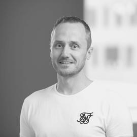

{width=150px style="border-radius: 50%;"}

Hi, I’m Dr. Barrie Kersbergen.

My work combines technical leadership, machine learning, decision science, and research to address complex problems in large-scale e-commerce. I particularly focus on cross-organizational challenges where the problem itself, the right abstraction, or the technical direction is not yet clear.

Much of my work involves bringing together perspectives across teams and disciplines, challenging assumptions, developing and evaluating new approaches, and establishing technical direction that can be translated into practice and used by others. Research is an integral part of this work, and I occasionally publish about it and contribute to the broader research community.

A major focus of my current work is decision-making under uncertainty: moving beyond predicting what will happen to determining what to do when the future is uncertain. This includes probabilistic forecasting, uncertainty quantification and calibration, scenario-based planning, and methods that connect predictions to operational decisions.

My research spans machine learning, recommender systems, and decision-making in e-commerce. In my PhD thesis, *Expanding Boundaries in Scalable Session-Based Recommendations*, I investigated scalable recommendation under real-world constraints, including massive product catalogs, billions of interactions, sparse behavioral data, strict latency requirements, and data quality issues. The research demonstrates that well-designed nearest-neighbor algorithms can rival or outperform deep learning approaches on large-scale recommendation tasks, particularly when computational and production constraints are taken into account. It also explores resource-aware benchmarking and scalable data debugging and Data Shapley value estimation.

Across these areas, I am particularly interested in methods that are not only technically strong, but also scalable, uncertainty-aware, and useful for real-world decisions.

This website brings together my publications, research, teaching, and other academic and professional work.